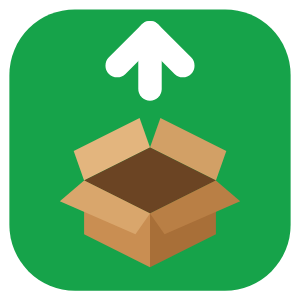
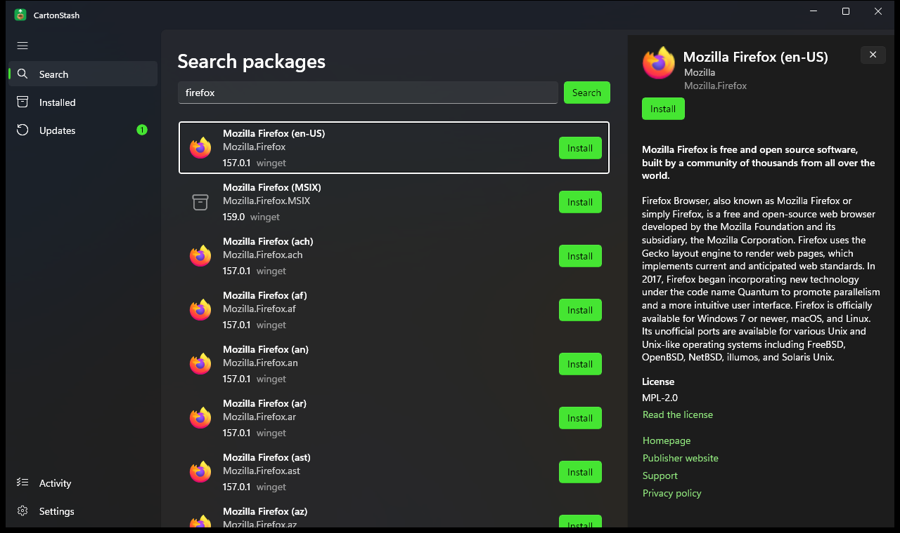
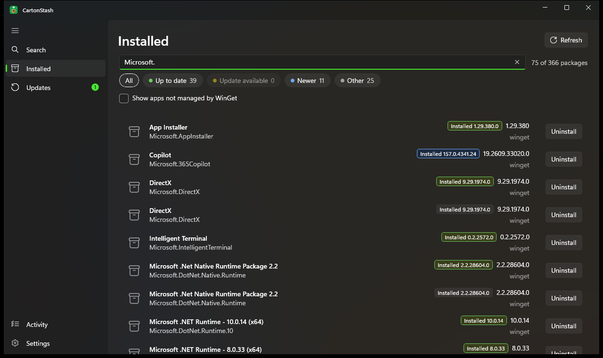
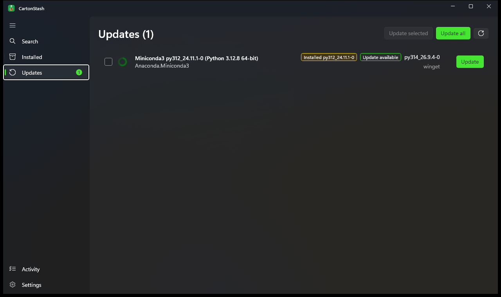

<p align="center">
  
</p>

<h1 align="center">CartonStash</h1>

<p align="center">
  <strong>A WinGet GUI for Windows 11 and 10: search, install, update and uninstall apps with a native app.</strong>
</p>

<p align="center">
  <a href="https://github.com/anthonyda/CartonStash/releases/latest"></a>
  <a href="https://github.com/anthonyda/CartonStash/actions/workflows/ci.yml"></a>
  
  
</p>

CartonStash is a free **graphical interface for WinGet**, the Windows Package Manager (`winget`). Find software, install
it with one click, see everything installed on your PC, and **update all your apps at once**, without typing commands.
It talks to WinGet directly through its official API, so what you see is exactly what `winget` knows.



## Features

- **Search and install apps** from the WinGet community repository and the Microsoft Store source, with the package
  description, license, publisher links, tags, release notes and every available version.
- **See every installed program**, including apps WinGet didn't install, one row per program, the same list as
  `winget list`. Filter by name, ID or status.
- **Color-coded versions** so you see at a glance what is up to date, has an update, is newer than the source, or can't
  be compared. The status chips double as the legend and as one-click filters.
- **Update apps on Windows**: one package, a selection, or **Update all** with a confirmation first.
- **Uninstall programs** cleanly, with a confirmation that names exactly what will be removed.
- **Progress for everything**: downloads, installs and uninstalls run one at a time in a queue, with cancel (while
  downloading), retry, and a clear success or error message.
- **Runs without admin rights.** When an installer needs administrator access, Windows asks for that installer only.
- **Settings**: light / dark theme, start page, default install scope (current user or all users), WinGet sources with
  refresh, and copyable diagnostic info.
- **Accessible**: keyboard navigation, screen reader names, light, dark and high-contrast themes.

| Installed apps, filtered by status | Available updates |
|---|---|
|  |  |

## Download and install

Get the latest version from **[Releases](https://github.com/anthonyda/CartonStash/releases/latest)**:

- **Installer (MSIX)**, recommended: `CartonStash_<version>_x64.msix` (or `_arm64` for Arm PCs). Adds CartonStash to
  Start and uninstalls cleanly from Settings → Apps.
- **Portable (zip)**: `CartonStash_<version>_x64_portable.zip`. Unzip anywhere and run `CartonStash.exe`. Nothing to install.

The MSIX is signed with CartonStash's own certificate, which Windows doesn't trust out of the box yet. Trust it once
(as administrator), then double-click the `.msix`:

```powershell
Import-Certificate -FilePath .\CartonStash.cer -CertStoreLocation Cert:\LocalMachine\TrustedPeople
```

Each release lists SHA-256 checksums in `SHA256SUMS.txt`.

**Requirements:** Windows 10 version 2004 (build 19041) or later, or Windows 11, with
[App Installer](https://apps.microsoft.com/detail/9NBLGGH4NNS1) (WinGet) 1.29 or later. Nothing else: .NET and the
Windows App SDK are included.

## FAQ

**Is CartonStash an official Microsoft app?**
No. It's an independent project and is not affiliated with or endorsed by Microsoft. "WinGet" and "Windows" are
Microsoft's names; CartonStash only uses WinGet's public API.

**How is it different from `winget` in a terminal?**
It does the same work through the same engine, with a visual list, filters, version colors, details and progress
instead of commands and tables. You can mix both: changes made in either show up in the other after a refresh.

**Why does Update all skip some apps?**
WinGet refuses apps that are pinned or need explicit targeting; their Activity entry says why. Marking them in advance
is planned in [#1](https://github.com/anthonyda/CartonStash/issues/1).

**Where are my settings?**
`%LOCALAPPDATA%\CartonStash\settings.json` for the portable app; the MSIX keeps them in its own app-data folder.

## Build from source

Requirements: Windows 10/11, the [.NET 10 SDK](https://dotnet.microsoft.com/download), App Installer (WinGet) 1.29+.
Visual Studio 2026 with the *WinUI application development* workload is optional; the CLI is enough.

```powershell
dotnet build                                   # whole solution
dotnet run --project src/CartonStash.App       # run the app
dotnet test --filter "Category!=Integration"   # unit tests (add integration tests with plain `dotnet test`)
.\tools\Publish-Release.ps1 -Version 1.2.3     # signed MSIX + portable zip in artifacts\
```

Keep the repository at a short path (for example `C:\dev\CartonStash`): long paths break the XAML compiler.

**Built with** C# and .NET 10, WinUI 3 (Windows App SDK), the WinGet COM API (`Microsoft.WindowsPackageManager.ComInterop`),
CommunityToolkit.Mvvm and xUnit.

## How it's built: spec-driven development

CartonStash isn't improvised feature by feature. It follows **spec-driven development (SDD)**: nothing is coded until it
has been written down, reviewed and approved, and nothing counts as done until it has been verified against that spec.

- **Specs first.** Each feature has its own folder in [`specs/`](specs/README.md) with numbered requirements written as
  testable acceptance criteria, a design, and an ordered task list. Implementation starts only once both the
  requirements and the design are approved.
- **Rules that don't bend.** A [constitution](specs/constitution.md) sets the non-negotiables: WinGet is the single
  source of truth, nothing is installed or removed without an explicit user action, the app never runs as administrator,
  and only one layer of the code talks to WinGet.
- **Traceable and tested.** Requirement IDs (e.g. `R6.5`) are carried into test names and code comments, so every
  behaviour can be traced back to the requirement it fulfils. More than 150 automated tests cover the logic, including
  integration tests against a real WinGet.
- **Verified, not assumed.** Each spec keeps a dated verification log of what was checked in the running app and how.
  When testing shows the spec itself was wrong, the spec is corrected first and the change is recorded, so the
  documentation and the code never drift apart.
- **Checked on every change.** Every push is built and tested by [CI](https://github.com/anthonyda/CartonStash/actions/workflows/ci.yml);
  releases are produced by the same script every time, signed, and published with SHA-256 checksums.

Ideas and bug reports are welcome as [issues](https://github.com/anthonyda/CartonStash/issues). New features start the
same way: as a spec.
