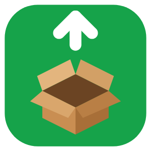
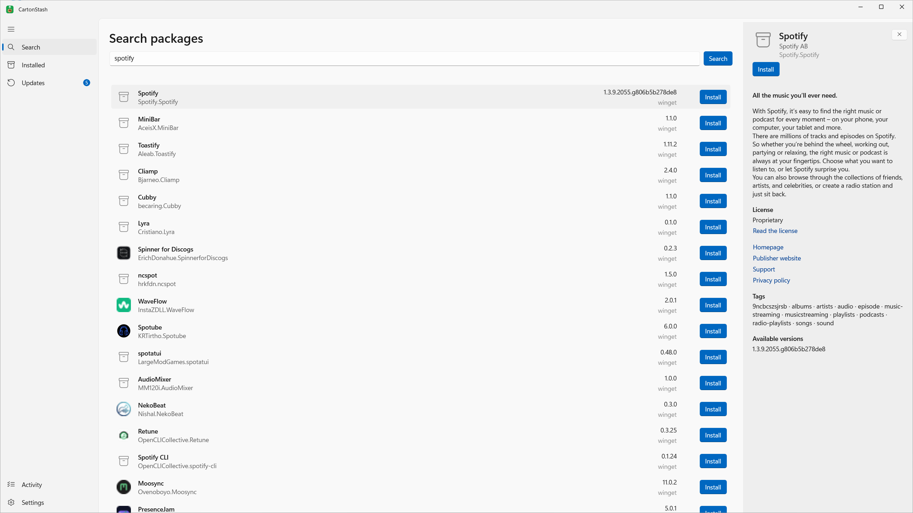
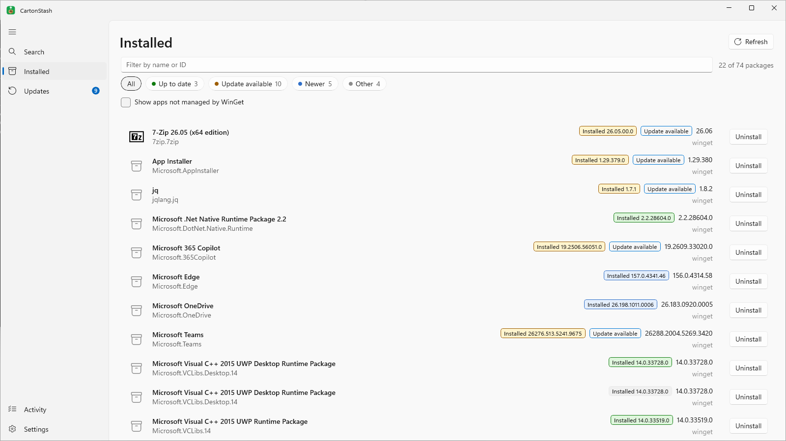
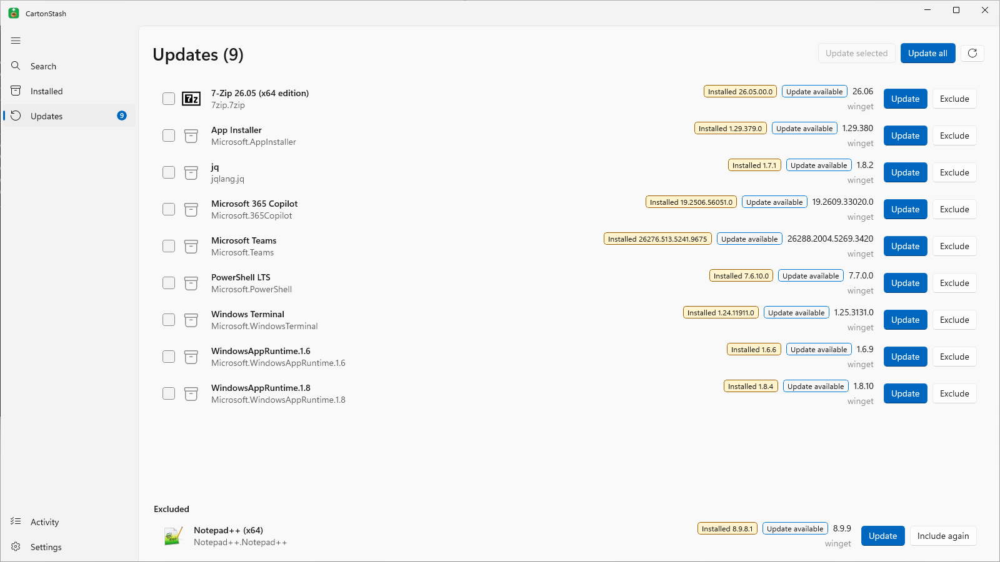
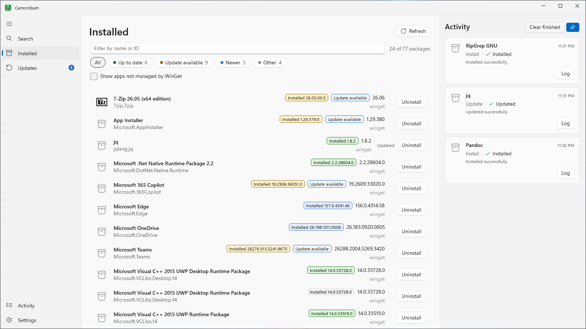
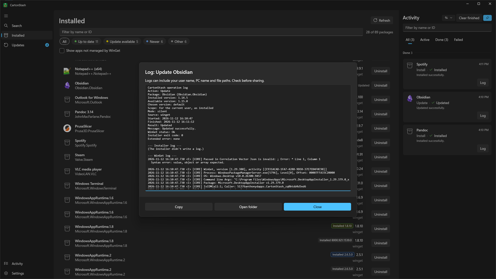

<p align="center">
  
</p>

<h1 align="center">CartonStash</h1>

<p align="center">
  <strong>A WinGet GUI for Windows 11 and 10: search, install, update and uninstall apps with a native app.</strong>
</p>

<p align="center">
  <a href="https://apps.microsoft.com/detail/9MT37M7DBZRK"></a>
</p>

<p align="center">
  <a href="https://github.com/anthonyda/CartonStash/blob/main/CHANGELOG.md"></a>
  <a href="https://github.com/anthonyda/CartonStash/actions/workflows/ci.yml"></a>
  
  
</p>

CartonStash is a free **graphical interface for WinGet**, the Windows Package Manager (`winget`). Find software, install
it with one click, see everything installed on your PC, and **update all your apps at once**, without typing commands.
It talks to WinGet directly through its official API, so what you see is exactly what `winget` knows.



## Features

- **Search and install apps** from the WinGet community repository and, once you accept its agreements, the Microsoft Store source, with the package
  description, license, publisher links, tags, release notes and every available version.
- **See every installed program**, including apps WinGet didn't install, one row per program, the same list as
  `winget list`. Filter by name, ID or status.
- **Color-coded versions** so you see at a glance what is up to date, has an update, is newer than the source, or can't
  be compared. The status chips double as the legend and as one-click filters.
- **Update apps on Windows**: one package, a selection, or **Update all** with a confirmation first.
- **Uninstall programs** cleanly, with a confirmation that names exactly what will be removed.
- **Progress for everything**: downloads, installs and uninstalls run one at a time in a queue, with cancel (while
  downloading), retry, and a clear success or error message. Pin the Activity pane to keep it open beside the page.
- **Background update checks**, optional and off by default: on a schedule you choose, Windows runs a short check, even with the app closed, and a notification tells you what's waiting. It never installs anything by itself. Exclude any package you don't want to hear about. Microsoft Store version only.
- **Logs when something fails**: every operation keeps a log with WinGet's result and the installer's own output, ready
  to read or copy into a bug report.
- **Runs without admin rights.** When an installer needs administrator access, Windows asks for that installer only.
- **Settings**: light / dark theme, start page, default install scope (current user or all users), WinGet sources with
  refresh, and copyable diagnostic info.
- **Accessible**: keyboard navigation, screen reader names, light, dark and high-contrast themes.

| Installed apps, filtered by status | Available updates |
|---|---|
|  |  |

| Activity pane, pinned beside the page | Operation log |
|---|---|
|  |  |

## Download and install

Get CartonStash from the **[Microsoft Store](https://apps.microsoft.com/detail/9MT37M7DBZRK)**. Microsoft signs it, and
Windows keeps it up to date. You can also install it from a terminal:

```powershell
winget install 9MT37M7DBZRK --source msstore
```

See what's new in each version in the [changelog](CHANGELOG.md).

**Requirements:** Windows 10 version 2004 (build 19041) or later, or Windows 11, with
[App Installer](https://apps.microsoft.com/detail/9NBLGGH4NNS1) (WinGet) 1.29 or later. The Store installs everything else
the app needs.

## FAQ

**Is CartonStash an official Microsoft app?**
No. It's an independent project and is not affiliated with or endorsed by Microsoft. "WinGet" and "Windows" are
Microsoft's names; CartonStash only uses WinGet's public API.

**How is it different from `winget` in a terminal?**
It does the same work through the same engine, with a visual list, filters, version colors, details and progress
instead of commands and tables. You can mix both: changes made in either show up in the other after a refresh.

**Why does Update all skip some apps?**
WinGet refuses apps that are pinned or need explicit targeting; their Activity entry says why. Marking them in advance
is planned in [#1](https://github.com/anthonyda/CartonStash/issues/1).

**Where are my settings?**
The Store version keeps them in its own app-data folder. A build of your own uses `%LOCALAPPDATA%\CartonStash\settings.json`.

**What does CartonStash connect to?**
WinGet does the searching and downloading. CartonStash itself only loads package icons, over https, from the addresses in
package manifests, so those hosts can see your IP address. When you press **Show notes from GitHub** in a package's
details, it also asks `api.github.com` for that one release's notes, without signing in; GitHub can see your IP address
too. It has no telemetry of its own.

## Build from source

Requirements: Windows 10/11, the [.NET 10 SDK](https://dotnet.microsoft.com/download), App Installer (WinGet) 1.29+.
Visual Studio 2026 with the *WinUI application development* workload is optional; the CLI is enough.

```powershell
dotnet build                                   # whole solution
dotnet run --project src/CartonStash.App       # run the app
dotnet test --filter "Category!=Integration"   # unit tests (add integration tests with plain `dotnet test`)
.\tools\Publish-Release.ps1 -Version 1.2.3     # portable zip in artifacts\, Store MSIX in store\
```

You don't need a certificate for any of this. To get a copy you can keep, run `Publish-Release.ps1` (add
`-Runtimes win-x64` to build for x64 only), unzip `artifacts\CartonStash_<version>_x64_portable.zip` anywhere and run
`CartonStash.exe`. It has everything it needs, but it isn't signed, and background update checks need the Store version.

Keep the repository at a short path (for example `C:\dev\CartonStash`): long paths break the XAML compiler.

**Built with** C# and .NET 10, WinUI 3 (Windows App SDK), the WinGet COM API (`Microsoft.WindowsPackageManager.ComInterop`),
CommunityToolkit.Mvvm and xUnit.

## How it's built: spec-driven development

CartonStash is built with AI: [Claude](https://www.anthropic.com/claude), Anthropic's AI model, writes most of the code and
specs. It isn't improvised feature by feature, though. It follows **spec-driven development (SDD)**: nothing is coded
until it has been written down, reviewed and approved, and nothing counts as done until it has been verified against
that spec.

- **A human decides.** The maintainer reviews and approves every requirement and design, makes the product decisions,
  and approves each release. Claude proposes, implements and verifies; it doesn't decide what ships.
- **Specs first.** Each feature has its own folder in [`specs/`](specs/README.md) with numbered requirements written as
  testable acceptance criteria, a design, and an ordered task list. Implementation starts only once both the
  requirements and the design are approved.
- **Rules that don't bend.** A [constitution](specs/constitution.md) sets the non-negotiables: WinGet is the single
  source of truth, nothing is installed or removed without an explicit user action, the app never runs as administrator,
  and only one layer of the code talks to WinGet.
- **Traceable and tested.** Requirement IDs (e.g. `R6.5`) are carried into test names and code comments, so every
  behaviour can be traced back to the requirement it fulfils. More than 150 automated tests cover the logic, including
  integration tests against a real WinGet.
- **Verified, not assumed.** Each spec keeps a dated verification log of what was checked in the running app and how.
  When testing shows the spec itself was wrong, the spec is corrected first and the change is recorded, so the
  documentation and the code never drift apart.
- **Checked on every change.** Every push is built and tested by [CI](https://github.com/anthonyda/CartonStash/actions/workflows/ci.yml);
  releases are built by the same workflow every time, and Microsoft signs them after Store certification.

Ideas and bug reports are welcome as [issues](https://github.com/anthonyda/CartonStash/issues). New features start the
same way: as a spec.

## License

CartonStash is released under the [MIT License](LICENSE).
